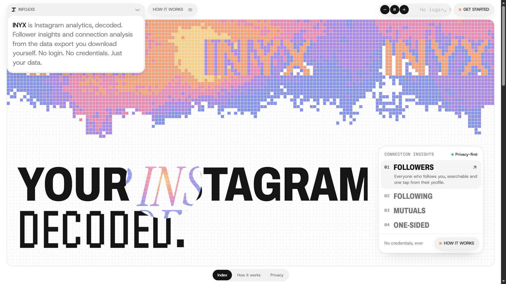
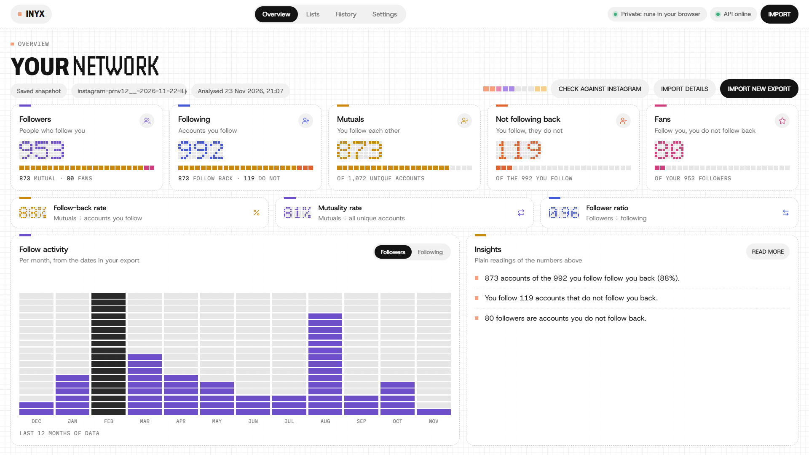

<p align="center">
  
</p>

<h1 align="center">Instalytics (INYX)</h1>

<p align="center"><strong>Your Instagram, decoded.</strong></p>

INYX is a privacy-first analytics tool for your own Instagram data. Upload the ZIP from Instagram's official
data export and see who follows you, who you follow, your mutuals and who doesn't follow back. No login, no
credentials: your export is read and analysed entirely in your browser.

<p align="center">
  
  
</p>

## Features

- Import an Instagram data export (JSON) as a ZIP, validated before anything is read.
- Followers, following, mutuals, not-following-back and fans, with counts and rates.
- Searchable, sortable account lists with a link to each Instagram profile.
- Per-category pages with charts and plain-language insights.
- Warnings when an export looks incomplete (missing files, date-range limits).
- Optional comparison against the counts Instagram shows, and manual marking of unavailable accounts.
- Optional snapshots saved on your device, with a History view that compares them.
- CSV export, and a one-click delete of everything stored locally.

## Tech stack

| Area | Technology |
| --- | --- |
| Frontend | React 19, TypeScript, Vite, Tailwind CSS v4, React Router |
| Browser processing | fflate (ZIP), IndexedDB (optional snapshots) |
| Backend | Python 3.12, FastAPI, Pydantic |
| Tests and checks | Vitest, Testing Library, pytest, Ruff, oxlint |
| Deployment | Vercel (frontend), Render with Docker (backend) |

## Architecture

```text
 Instagram export (.zip)
          |
          v
 +-------------------------------+            +---------------------------+
 | Browser (React app)           |  health    | API (FastAPI)             |
 |  ZIP validation and parsing   | ---------> |  /api/v1/health/live      |
 |  analytics, charts, CSV       |   only     |  /api/v1/health/ready     |
 |  optional snapshots (IndexedDB)|           |  stateless, no storage    |
 +-------------------------------+            +---------------------------+
```

The browser never sends your export or account lists to the API. It only calls the health check to show an
API status indicator, and the app works fully without the backend. The backend also contains a Python parser
and analytics module that mirror the frontend's, kept in sync by shared test cases. See
[`docs/frontend/architecture.md`](docs/frontend/architecture.md).

## Local setup

Requires Node.js 22 or 24 and Python 3.11 or newer.

```bash
# backend (terminal 1)
cd backend
python -m venv .venv && . .venv/bin/activate     # Windows: .\.venv\Scripts\Activate.ps1
pip install -r requirements-dev.txt
uvicorn app.main:app --reload --port 8000

# frontend (terminal 2)
cd frontend
npm ci
npm run dev
```

Open <http://localhost:5173>. The dev server proxies `/api` to the backend on port 8000. On Windows,
`.\scripts\dev.ps1` starts both. More detail is in [`docs/setup/local-development.md`](docs/setup/local-development.md).

Checks:

```bash
cd frontend && npm run lint && npm test && npm run build
cd backend && ruff check . && ruff format --check . && pytest -q
```

## Environment variables

Copy the examples and adjust only if needed; neither file is required for local development.

| File | Variables |
| --- | --- |
| [`backend/.env.example`](backend/.env.example) | `APP_ENV`, `CORS_ORIGINS`, `LOG_LEVEL`, `LOG_JSON`, optional `REDIS_URL` and request/ZIP limits |
| [`frontend/.env.example`](frontend/.env.example) | `VITE_API_URL` (production), `VITE_DEV_API_TARGET` (development) |

`VITE_*` values are public in the built bundle; never put secrets in them. Deployment steps for Render and
Vercel are in [`docs/deployment/render-vercel.md`](docs/deployment/render-vercel.md).

## Privacy and security

- No Instagram credentials, cookies or tokens are ever requested.
- The export is processed in your browser and is never uploaded or stored. Nothing is saved unless you choose to
  keep a snapshot, which holds derived usernames and counts only and lives in your browser's IndexedDB.
- No third-party analytics. Backend logs contain request metadata only, never Instagram data.
- ZIP safeguards: size, entry-count and compression-ratio limits, path validation, unknown file types rejected,
  and only the relevant JSON files are read.
- INYX is read-only: it never follows, unfollows or messages on your behalf.
- Imported text is rendered as plain text, profile links are validated, and CSV exports neutralise spreadsheet formulas.

## License

No license file is included in this repository.
